# Running a sample fashion-search query

Follow the [setup guide](set-up.md) first. With your environment activated and catalogue ready, run the commands below from the repository root.

This walkthrough runs a query and reviews its real top-five results for each detected garment.

## 1. Run one query

The recorded example uses the local `query-images/22.png`: a person wearing a green half-zip pullover, light trousers and a small visible inner top. Local query photos are not redistributed in this repository.

```bash
python -m src.pipeline --photo query-images/22.png --output results/manual-query-results.txt
```

To query your own photo, replace the input path:

```bash
python -m src.pipeline --photo /path/to/your/outfit.jpg --output results/manual-query-results.txt
```

The command detects and crops each garment, classifies its color, embeds the crop, retrieves up to 100 candidates within its broad category, then reranks and writes the top five. Manual-query results are **appended to** `results/manual-query-results.txt`. The three other result files are reserved for the normal, segmented and cropped query sets.

## 2. Read the recorded top-five results

The tables below come from a real CPU run of the current pipeline against `22.png`. Each detection has its own top five. Product thumbnails are copies of the returned synthetic catalogue images, bundled here so the results remain visible without downloading the full catalogue.

`Image similarity` is the normalized image-embedding dot product. `Reranked score` includes a category match adjustment (+0.04) and, when color is available, a color match adjustment (+0.04) or mismatch adjustment (−0.03). These are ranking signals, not match probabilities. Scores are not a quality rating or an accuracy measurement.

### Green pullover

Detected category: `outer`. Predicted base color: **green**.

The strongest matches are green knit pullovers; several share the visible half-zip construction. This is qualitative inspection of one example.

| Rank | Product | Image | Image similarity | Reranked score |
| --- | --- | --- | ---: | ---: |
| 1 | **SYN-013137**<br>green slim wool-cashmere fine-gauge knit high-neck half-zip pullover | 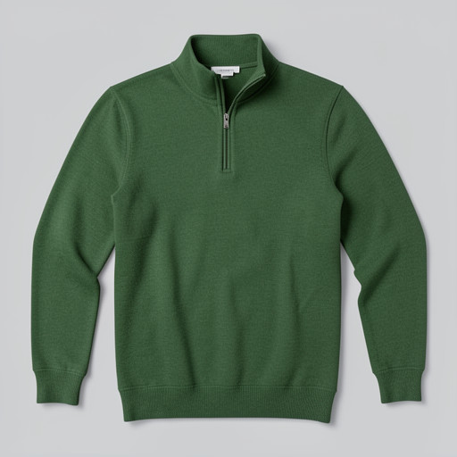 | 0.8254 | 0.9054 |
| 2 | **SYN-013122**<br>green regular merino wool fine-gauge knit high-neck half-zip pullover | 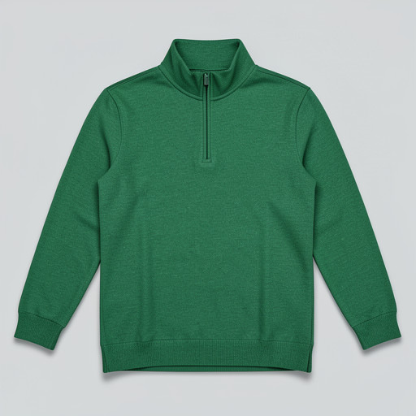 | 0.8065 | 0.8865 |
| 3 | **SYN-013125**<br>green regular cotton fine-gauge knit roll-neck pullover | 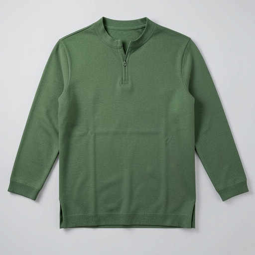 | 0.8004 | 0.8804 |
| 4 | **SYN-013162**<br>green oversized lambswool medium-gauge knit high-neck half-zip pullover | 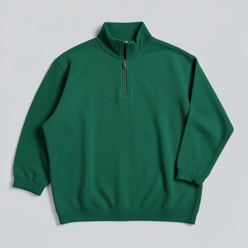 | 0.7952 | 0.8752 |
| 5 | **SYN-013111**<br>green regular merino wool fine-gauge knit high-neck half-zip pullover | 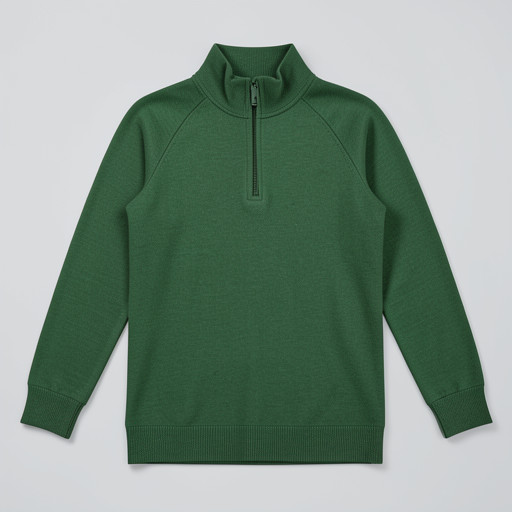 | 0.7947 | 0.8747 |

### Trousers

Detected category: `bottom`. Predicted base color: **khaki**.

Segmentation was empty for this detection, so the color classifier used the detector crop directly. It selected khaki; the photo’s light neutral trousers illustrate the ambiguity of nearby colors under real lighting.

| Rank | Product | Image | Image similarity | Reranked score |
| --- | --- | --- | ---: | ---: |
| 1 | **SYN-001387**<br>khaki slim stretch cotton sateen full-length flat-front trousers | 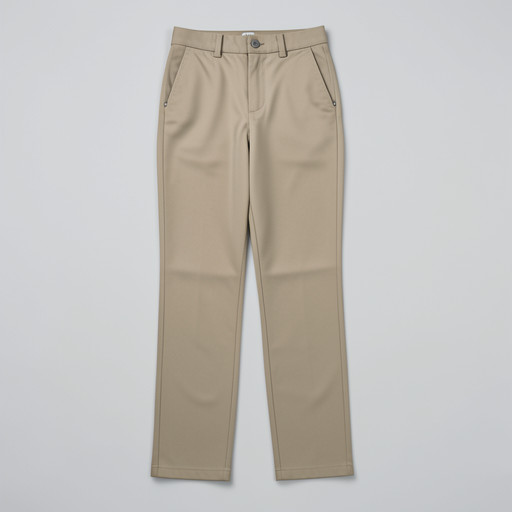 | 0.7382 | 0.8182 |
| 2 | **SYN-001442**<br>khaki slim cotton-linen woven fabric full-length flat-front trousers | 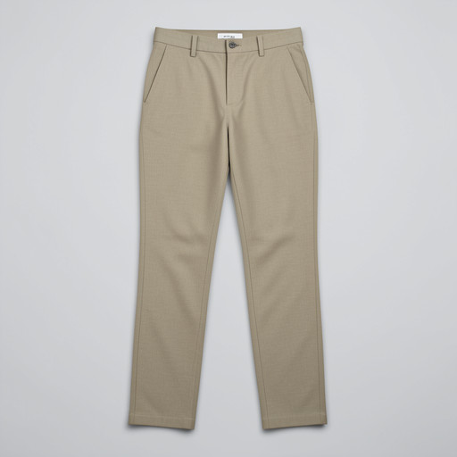 | 0.7350 | 0.8150 |
| 3 | **SYN-001368**<br>khaki regular polyester-viscose suiting mid-rise cropped trousers | 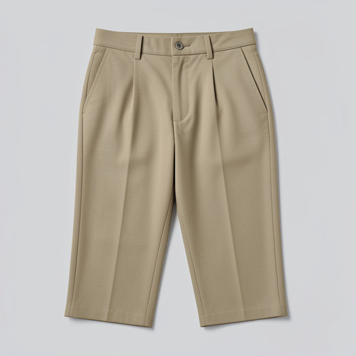 | 0.7312 | 0.8112 |
| 4 | **SYN-001420**<br>khaki slim stretch cotton sateen high-rise tapered trousers | 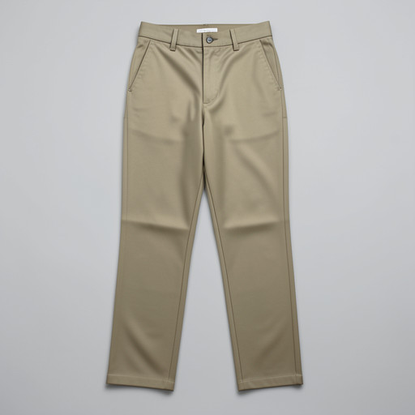 | 0.7242 | 0.8042 |
| 5 | **SYN-001402**<br>khaki regular cotton chino twill high-rise wide-leg trousers | 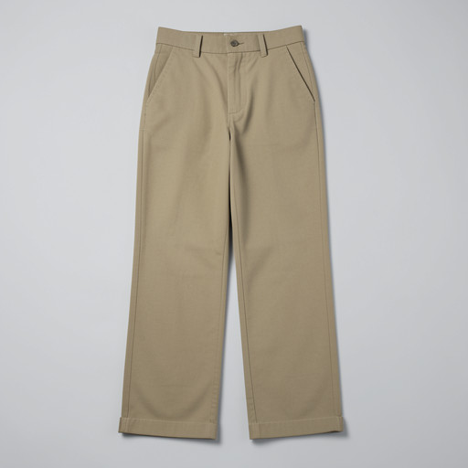 | 0.7210 | 0.8010 |

### Small inner-top crop

Detected category: `top`. Predicted base color: **unknown (color reranking skipped)**.

The small inner-top crop was ambiguous between white and orange, so color contributed no bonus or penalty. Retrieval returned black T-shirts despite the light visible inner top. This is a failure case, not a successful color match.

| Rank | Product | Image | Image similarity | Reranked score |
| --- | --- | --- | ---: | ---: |
| 1 | **SYN-006144**<br>black slim cotton single jersey bound crew-neck T-shirt | 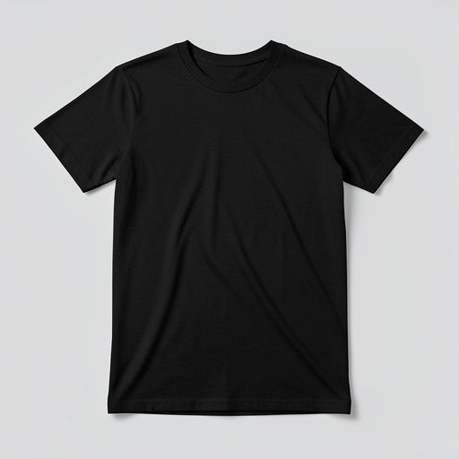 | 0.6580 | 0.6980 |
| 2 | **SYN-006127**<br>black regular cotton single jersey ribbed crew-neck T-shirt | 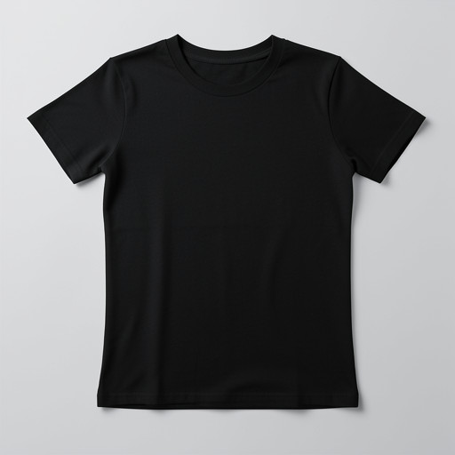 | 0.6480 | 0.6880 |
| 3 | **SYN-006147**<br>black regular cotton-elastane jersey ribbed crew-neck T-shirt | 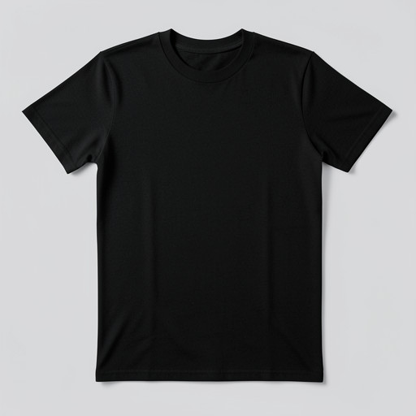 | 0.6464 | 0.6864 |
| 4 | **SYN-006133**<br>black slim cotton-modal jersey wide crew-neck T-shirt | 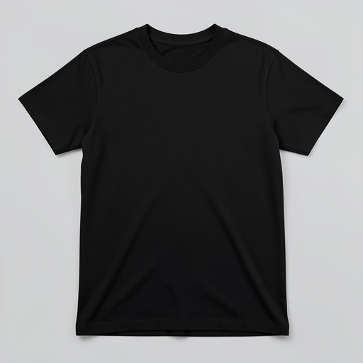 | 0.6462 | 0.6862 |
| 5 | **SYN-006023**<br>black slim cotton-elastane jersey wide crew-neck T-shirt | 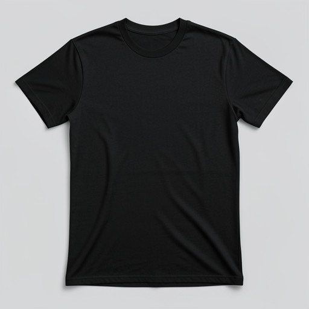 | 0.6427 | 0.6827 |

The complete recorded text output is available in [example-results.txt](docs/walkthrough/example-results.txt). The example is a saved snapshot: changing models, catalogue files, software versions or the query photo can change the returned order and scores.

## 3. View the saved result images

The saved example images are included in [`docs/walkthrough/`](docs/walkthrough/). Find a product by its ID, for example [SYN-013137.jpg](docs/walkthrough/SYN-013137.jpg). These images can be viewed directly on GitHub.

Look up the same `product_id` in `data/synthetic-catalogue/product_catalogue_30000.csv` to inspect its intended fabric, fit, construction and design. Synthetic images can deviate from those intended attributes; judge the image as well as its metadata.

For a batch comparison across existing local original/cropped/segmented query folders, use:

```bash
python -m src.test_query_images
```

That command loads the pipeline once and appends results to the three corresponding files under `results/`. A missing garment category or an uncertain color can legitimately produce no matches or no color adjustment. This walkthrough demonstrates execution and exposes limitations; retrieval-effectiveness evaluation is a separate task.
